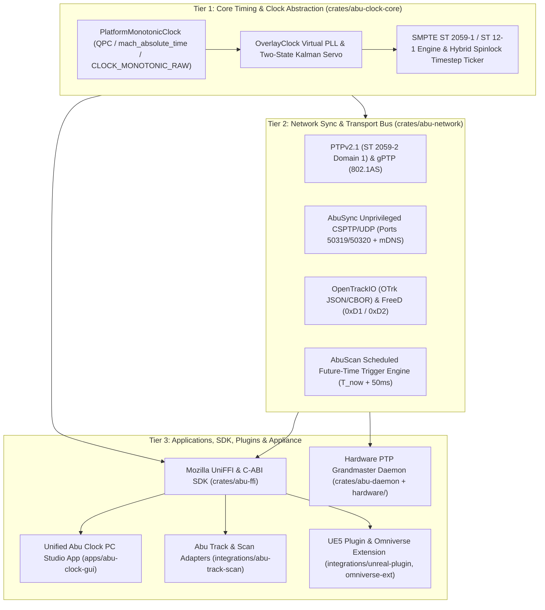

# Abu Clock (`abu-clock`)

**Cross-Platform Precision SMPTE Timecode, Deterministic Timestep (`Hz`) Synchronization, and Hardware-Ready PTP/gPTP Master Clock Engine**

[](./VERSION)
[](#license)
[](https://ahmademranian.dev/products)

**Abu Clock (`abu-clock`)** is a cross-platform software and hardware-ready timing engine engineered to deliver broadcast-grade **SMPTE ST 2059-1 / ST 12-1 timecode (`HH:MM:SS:FF.sf`)** and deterministic frequency **timestep (`Hz`)** synchronization across standard local area networks (Gigabit Ethernet, USB-C LAN adapters, and Wi-Fi). Designed as the temporal backbone of the **Abu** creative technology ecosystem alongside **[Abu Track & Scan (`CamTrack-Pro-01`)](https://github.com/saemranian/CamTrack-Pro-01)** and **Abu Cam**, it bridges independent Virtual Production (VP), AR broadcast, and 3D Gaussian Splatting (3DGS) spatial capture pipelines with enterprise broadcast timing.

---

## Documentation & Manuals

- **[User Manual & Studio Operator Guide (`docs/USER_MANUAL.md`)](./docs/USER_MANUAL.md)** — Complete step-by-step operational guide to the unified **Abu Clock** 5-tab PC Studio application, parameter hover guides, 1-click studio presets, multi-rig barrier triggering, and pre-shoot checklist.
- **[Developer & Systems Integration Guide (`docs/DEVELOPER_GUIDE.md`)](./docs/DEVELOPER_GUIDE.md)** — Complete technical reference for Rust crates, C/C++17 native FFI (`abu_clock.h`), Python & NVIDIA Omniverse (`omni.abu.clock`), Unreal Engine 5 (`AbuClockUE`), iOS Swift (`AbuClockKit`), and the local HTTP JSON REST API (`127.0.0.1:7878`).
- **[Abu Track & Scan Ecosystem Integration Guide (`docs/ABU_TRACK_AND_SCAN_INTEGRATION_GUIDE.md`)](./docs/ABU_TRACK_AND_SCAN_INTEGRATION_GUIDE.md)** — Architectural interoperability blueprint & drop-in recipes connecting the `Abu Track & Scan` iOS Swift app, Windows Desktop Sync & Monitor, and Unreal Engine 5 `LiveLinkAbuTrack` plugin to `Abu Clock`.
- **[MCP Server & HTTP API Guide (`docs/MCP_AND_API_GUIDE.md`)](./docs/MCP_AND_API_GUIDE.md)** — Complete guide to the native Model Context Protocol (`abu-clock-mcp.exe`) server, global Antigravity skill (`abu-clock`), 7 MCP tools, and HTTP REST endpoints.
- **[Fundamentals, Architecture & Graphical Guide (`docs/ABU_CLOCK_USER_GUIDE.md`)](./docs/ABU_CLOCK_USER_GUIDE.md)** — Deep dive into hardware monotonic clocks, 2-state Kalman PLL servo math, TAI vs. UTC, SMPTE ST 12-1 Drop-Frame arithmetic, and future-time barrier triggering.
- **[Running & Testing Guide (`docs/RUNNING_AND_TESTING_GUIDE.md`)](./docs/RUNNING_AND_TESTING_GUIDE.md)** — Quick PowerShell commands to launch the PC app and run all automated tests.
- **[Hardware Appliance BOM (`docs/HARDWARE_APPLIANCE_BOM.md`)](./docs/HARDWARE_APPLIANCE_BOM.md)** — Raspberry Pi CM4 / Pi 5 + Maxim DS3231 TCXO + Intel I210-T1 Grandmaster hardware specification.

---

## Key Capabilities

| Attribute | Specification |
| :--- | :--- |
| **Target Platforms** | Windows 10/11 (`x86_64`/`ARM64`), macOS 13+ (Apple Silicon/Intel), Linux (`x86_64`/`ARM64`), iOS 16+, Android 10+ |
| **Core Timing Protocols** | IEEE 1588-2019 (`PTPv2.1`), SMPTE ST 2059-1/2, IEEE 802.1AS (`gPTP`), Client-Server PTP (`CSPTP`), SNTPv4 |
| **Application Transports** | `AbuSync` UDP (`50319`/`50320` + mDNS `_abuclock._udp.local.`), OpenTrackIO (`OTrk` JSON/CBOR), FreeD (`0xD1` / `0xD2`) |
| **Supported Frame Rates** | `23.976`, `24`, `25`, `29.97` (DF/NDF), `30`, `48`, `50`, `59.94` (DF/NDF), `60`, `120 fps`, & LiDAR (`10`, `15`, `20 Hz`) |
| **Phase 3 Hardware Unit** | Raspberry Pi CM4 / Pi 5 (`/dev/ptp0`), Maxim DS3231 TCXO ($\pm 2\text{ ppm}$), optional Intel I210-T1 (`/dev/ptp1`) |

---

## System Architecture



---

## Mathematical Foundations

### 1. User-Space `OverlayClock` Discipline Equation
Rather than requiring root or Administrator privileges to overwrite the host OS kernel clock, `OverlayClock` wraps the platform's highest-resolution monotonic hardware counter (`QueryPerformanceCounter` on Windows, `mach_absolute_time` on macOS/iOS, `CLOCK_MONOTONIC_RAW` on Linux/Android) in a lock-free seqlock PLL:

$$T_{\text{TAI}}(t) = T_{\text{anchor}} + (C_{\text{mono}}(t) - C_{\text{mono}}(t_0)) \cdot (1 + \alpha_{\text{freq}}) + \theta_{\text{phase}}$$

### 2. SMPTE ST 2059-1 Epoch & Hybrid Spinlock Timestep Synthesis
Anchored to `1970-01-01T00:00:00 TAI`, every rational cadence $F = F_{\text{num}} / F_{\text{den}}$ has exact frame duration $D_{\text{frame}} = (10^9 \times F_{\text{den}}) / F_{\text{num}}$ and frame index $K_{\text{frame}} = \lfloor T_{\text{ns}} / D_{\text{frame}} \rfloor$. The `TimestepTicker` yields to the OS scheduler until $\Delta t_{\text{sleep}} - 500\text{ }\mu\text{s}$ and then executes a tight hardware spinlock (`core::hint::spin_loop()`) until $\phi = 0.0$ is crossed ($< 5\text{ }\mu\text{s}$ software jitter).

---

## Repository Structure

| Path | Description |
| :--- | :--- |
| [`crates/abu-clock-core`](./crates/abu-clock-core) | `PlatformMonotonicClock`, `OverlayClock` virtual PLL, 2-state Kalman servo, 7s warm-up gate, SMPTE ST 2059-1 / ST 12-1 engine, and spinlock `TimestepTicker`. |
| [`crates/abu-network`](./crates/abu-network) | 4-profile PTP/gPTP/AES67/AbuSync synchronization engine, SMPTE ST 2059-2 SM TLV (`0x000E9B`), `AbuScanCoordinator` ($T_{\text{now}} + 50\text{ ms}$ triggers), OpenTrackIO (`OTrk`), and FreeD (`0xD1`/`0xD2`). |
| [`crates/abu-ffi`](./crates/abu-ffi) | Mozilla UniFFI (`abu_clock.udl`), C/C++ ABI (`include/abu_clock.h`), Python bindings, and `.abuscan.json` / Colmap `images.txt` session manifest exporter. |
| [`crates/abu-daemon`](./crates/abu-daemon) | Standalone CLI and Phase 3 hardware Grandmaster service (`/dev/ptp0`, Maxim DS3231 TCXO seeding, `SCHED_FIFO` priority 80). |
| [`apps/abu-clock-gui`](./apps/abu-clock-gui) | Unified **Abu Clock** PC Studio (`abu-clock.exe`) with 5-tab Control Center, Digital Slate, live Kalman oscilloscope, and REST server (`127.0.0.1:7878`). |
| [`integrations/abu-track-scan`](./integrations/abu-track-scan) | `AbuClockKit` iOS Swift optical exposure midpoint wrapper and `AbuClockWinClient` Windows C++ aggregator for `CamTrack-Pro-01`. |
| [`integrations/unreal-plugin`](./integrations/unreal-plugin) | Unreal Engine 5 `AbuClockUE` plugin (`UAbuClockTimecodeProvider`, `UAbuClockCustomTimeStep`, `FAbuTrackLiveLinkSource`). |
| [`integrations/omniverse-ext`](./integrations/omniverse-ext) | NVIDIA Omniverse `omni.abu.clock` Kit extension synchronizing `omni.timeline` and OpenUSD stages. |
| [`hardware/`](./hardware) | Raspberry Pi CM4 / Pi 5 + Maxim DS3231 TCXO boot script (`init-ground-clock.sh`), `systemd` service, `smpte-st2059-2-gm.cfg`, and RoboSense E1R `gptp-master.cfg`. |
| [`docs/`](./docs) | User Manual, Developer Guide, Hardware BOM, Product Portfolio Specification, and per-task Walkthrough documentation (`P0-T1` through `P3-T4`). |

---

## Quick Start

```powershell
# 1. Launch the Unified Abu Clock PC Studio Application (or double-click Start-AbuClock.bat)
cargo run --release --bin abu-clock

# 2. Run all workspace unit tests across core, network, FFI, GUI shell, and hardware daemon
cargo test --workspace

# 3. Run the standalone Abu Clock Grandmaster / Follower CLI daemon
cargo run -p abu-daemon -- --appliance-mode --ticks 5
```

## License

Dual-licensed under **MIT** or **Apache-2.0** at your option.
