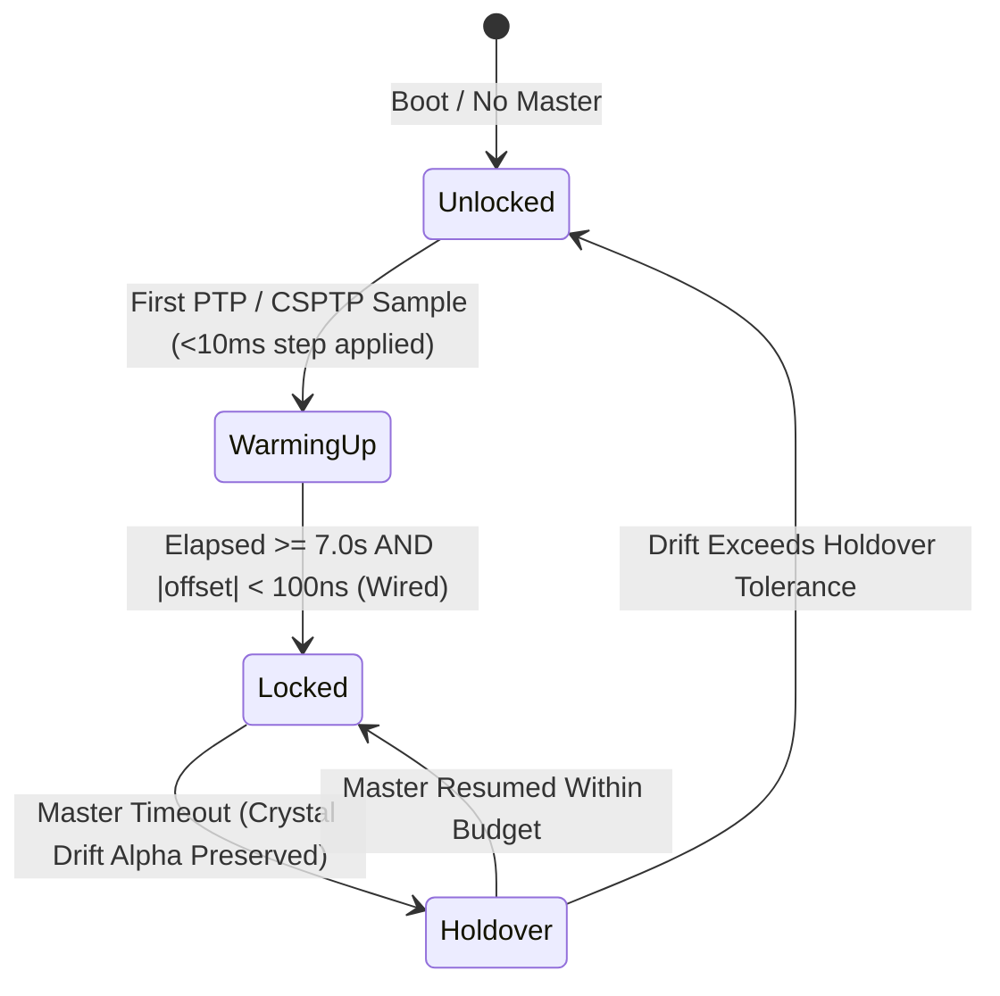

# Abu Clock — Fundamentals, Architecture & Graphical User Guide (`v0.0.0.12`)

Welcome to the official documentation and visual operating manual for **Abu Clock**, the unified PC Master Clock, SMPTE Timecode, and Multi-Sensor Synchronization Studio.

---

## Part 1: Why the App is Named `Abu Clock` (`abu-clock.exe`)

The central PC application is named **`Abu Clock`** (compiled binary: `target/release/abu-clock.exe`, launched via **`Start-AbuClock.bat`** or `cargo run --bin abu-clock`).
> [!NOTE]
> While the internal source folder is located at `apps/abu-clock-gui` inside the Cargo workspace to separate the UI crate from the low-level `crates/abu-clock-core` math library, the application itself is simply **Abu Clock**.

---

## Part 2: Core Engineering Fundamentals — How Abu Clock Works

### 1. Why Standard OS Wall-Clocks Fail & How `OverlayClock` Solves It
Standard operating system wall clocks (`SystemTime`, `gettimeofday`) are non-monotonic: background NTP services can step or slew them unpredictably, introducing multi-millisecond discontinuities that ruin multi-camera shutter alignment, LiDAR point-cloud stitching, and 3D Gaussian Splatting (3DGS).

**Abu Clock never modifies your operating system's wall clock.** Instead, `PlatformMonotonicClock` reads the hardware CPU oscillator counter directly:
- **Windows:** `QueryPerformanceCounter` (QPC)
- **macOS / iOS:** `mach_continuous_time`
- **Linux / Raspberry Pi CM4:** `CLOCK_MONOTONIC_RAW`

On top of this raw hardware counter, `OverlayClock` maintains a lock-free user-space virtual Phase-Locked Loop (PLL) that computes **International Atomic Time (TAI)** in nanoseconds:

$$T_{\text{TAI}}(t) = T_{\text{anchor}} + \bigl(C_{\text{mono}}(t) - C_{\text{mono}}(t_0)\bigr) \cdot (1 + \alpha_{\text{freq}}) + \theta_{\text{phase}}$$

where:
- $T_{\text{anchor}}$ is the synchronized TAI nanosecond anchor,
- $C_{\text{mono}}(t)$ is the hardware monotonic counter reading at instant $t$,
- $\alpha_{\text{freq}}$ is the crystal frequency drift steering ratio (stored in fixed-point parts-per-trillion for lock-free atomic reads),
- $\theta_{\text{phase}}$ is the residual phase correction in nanoseconds.

---

### 2. The 2-State Kalman PLL & 7.0-Second SMPTE ST 2059 Warm-Up Gate
Network packets traversing Ethernet switches or Wi-Fi access points experience variable queuing delay. To prevent network jitter from corrupting local frame pacing, `ClockKalmanFilter` tracks a 2-state vector:

$$\mathbf{x} = \begin{bmatrix} \theta_{\text{offset\_ns}} \\ \alpha_{\text{drift\_ppb}} \end{bmatrix}$$

- **Closed-Loop Steering:** On each PTP/CSPTP timing exchange, the Kalman innovation updates both the phase offset estimate and the local quartz crystal drift estimate (in parts-per-billion, $\text{ppb}$), applying closed-loop steering to `OverlayClock`.
- **Mandatory 7.0-Second Warm-Up Gate:** Per **SMPTE ST 2059-2**, a follower node must never report `LOCKED` immediately upon receiving its first packet. Abu Clock enforces a continuous **7.0-second (`7,000,000,000 ns`) warm-up convergence window** and verifies that residual phase error is within budget (`< 100 ns` on Wired Ethernet, `< 500 µs` on Wireless Wi-Fi) before transitioning to `LOCKED`.



---

### 3. International Atomic Time (TAI) & Rational SMPTE ST 12-1 Drop-Frame Math
- **TAI vs. UTC:** IEEE 1588 PTP and SMPTE ST 2059-2 operate on **TAI**, which is continuous and has no leap-second jumps (currently $\text{TAI} = \text{UTC} + 37\text{ seconds}$).
- **Exact Rational Frame Synthesis:** Every frame index $N$ since the SMPTE epoch is computed using 128-bit integer rational arithmetic (`fps_num / fps_den`) with zero floating-point accumulation error:
  $$N = \left\lfloor \frac{T_{\text{TAI}} \times F_{\text{num}}}{10^9 \times F_{\text{den}}} \right\rfloor$$
- **Drop-Frame (`29.97 DF` & `59.94 DF`) Compensation:** Because $30000/1001 \approx 29.97002997\text{ Hz}$ runs $0.1\%$ slower than $30.0\text{ Hz}$, SMPTE ST 12-1 Drop-Frame skips timecode labels `00` and `01` at the start of every minute **except** every 10th minute (`00, 10, 20, 30, 40, 50`). Each 10-minute block contains exactly `17,982` frames (`29.97 DF`) or `35,964` frames (`59.94 DF`).

---

### 4. Dual-Mode Network Synchronization & SMPTE ST 2059-2 TLV
Abu Clock supports four selectable synchronization profiles in `DualModePtpEngine`:
1. **AbuSync Unprivileged CSPTP (`UDP 50319/50320`):** Runs without administrator/root privileges on Windows, macOS, iOS, and Android using a four-timestamp ($t_1, t_2, t_3, t_4$) exchange:
   $$\theta = \frac{(t_2 - t_1) + (t_3 - t_4)}{2}, \quad d = \frac{(t_4 - t_1) - (t_3 - t_2)}{2}$$
2. **SMPTE ST 2059-2 Broadcast (`224.0.1.129`, Ports `319/320`):** Appends the 20-byte big-endian **SMPTE Synchronization Metadata TLV** (`tlvType = 0x0003`, OUI `00-0E-9B`, Subtype `00-00-01`) to PTP `Announce` frames so all followers automatically adopt the Grandmaster's frame rate and drop-frame flag.
3. **IEEE 802.1AS gPTP (`224.0.0.107`):** Layer-2 peer-to-peer profile for RoboSense E1R and XGRIDS L2PRO LiDAR sensors.
4. **AES67 + ST 2059-2 Harmonized (`AES-R16`):** Shared audio/video studio synchronization profile.

---

### 5. Future-Time Barrier Triggering (`SCHEDULE_CAPTURE_AT`)
Sending a naive UDP "capture now" packet across a network causes cameras to fire at different times due to variable network transit delay (`0.3 ms` on LAN up to `15 ms` on Wi-Fi).

```mermaid
sequenceDiagram
    participant M as Abu Clock Master
    participant C1 as iPhone 16 Pro (Wi-Fi)
    participant C2 as Windows Rig (LAN)
    participant L as RoboSense LiDAR (gPTP)

    Note over M: T_now = 100.000 s TAI
    M->>C1: Broadcast SCHEDULE_CAPTURE_AT(T_exec = 100.050 s, TC = 01:00:00;15)
    M->>C2: Broadcast SCHEDULE_CAPTURE_AT(T_exec = 100.050 s, TC = 01:00:00;15)
    M->>L: Broadcast SCHEDULE_CAPTURE_AT(T_exec = 100.050 s, TC = 01:00:00;15)
    Note over C1,L: Coarse OS sleep until T_exec - 500 µs, then tight hardware QPC/Mach spinlock
    Note over C1,L: ALL SENSORS FIRE AT EXACT T_exec = 100.050000000 s (< 50 µs spread)
```

---

### 6. Camera Tracking Telemetry (`OpenTrackIO` & `FreeD 0xD1 / 0xD2`) & Session Manifests
- **Standard FreeD (`0xD1`, 29 Bytes):** Legacy broadcast camera tracking packet carrying 24-bit fixed-point Pan/Tilt/Roll ($\times 32768$), X/Y/Z in millimeters ($\times 64$), Zoom, Focus, and a modulo-256 checksum (`0x40 - sum`).
- **Extended AbuTrack FreeD-TC (`0xD2`, 41 Bytes):** Extends `0xD1` with a 32-bit packed BCD SMPTE timecode word and 64-bit TAI nanosecond timestamp.
- **SMPTE RIS OpenTrackIO (`OTrk`):** Modern virtual production protocol with a 14-byte `OTrk` wire header, JSON/CBOR payload carrying 6-DoF transform, lens encoders, exact rational frame rate, and TAI/SMPTE timestamp.
- **Session Manifests (`.abuscan.json` & Colmap `images.txt`):** Exports synchronized multi-camera and LiDAR capture records directly into RealityCapture, Colmap, and Jawset Postshot for 3D Gaussian Splatting (3DGS).

---

## Part 3: Graphical Instruction Guide — How to Use the `Abu Clock` App

### Launching the Application
From Windows Explorer, double-click **`Start-AbuClock.bat`** in the repository root, or run from PowerShell:
```powershell
cargo run --bin abu-clock
```
This starts the live Rust engine on `http://127.0.0.1:7878` and automatically opens the native **Abu Clock** desktop window.

---

### Visual Map of the Unified `Abu Clock` Studio Interface

```
+---------------------------------------------------------------------------------------------------+
|  ABU CLOCK (v0.0.0.12 • QueryPerformanceCounter)    [LOCKED] [PORT: MASTER] [WIRED LAN] [WAKE ON] |
+---------------------------------------------------------------------------------------------------+
|  [1] MASTER DIGITAL SLATE RIBBON (Always Visible at Top)                                          |
|      00:08:14;22.41   Frame #14824 | BCD 0x00081422 | 29.970 Hz (DF) | Sub-Frame Phase [====   ]  |
|                                                                             [ FRAME 00 FLASH ]    |
+---------------------------------------------------------------------------------------------------+
|  [Tab 1: Clock & PLL] [Tab 2: PTP & TLV] [Tab 3: Trigger & Telemetry] [Tab 4: Appliance] [5: Help]|
+---------------------------------------------------------------------------------------------------+
|                                                                                                   |
|  +---------------------------------------------+  +--------------------------------------------+  |
|  | [2] PARAMETER SETTINGS PANEL                |  | [3] KALMAN PLL & OSCILLOSCOPE TEST BENCH   |  |
|  |  - Operating Role (Auto BMCA / Master / Flw)|  |  - KPIs: Offset (ns), Drift (ppb), Delay   |  |
|  |  - Sync Profile (AbuSync / ST2059 / gPTP)   |  |  - Live 40-Sample SVG Phase Oscilloscope   |  |
|  |  - Frame Rate (23.976 .. 120 fps, DF/NDF)   |  |  - [ + Inject Clean PTP Tick (±9 ns) ]     |  |
|  |  - PTP Domain, Priority 1 & 2, Phase Trim   |  |  - [ + Inject Wi-Fi Spike (+1,850 ns) ]    |  |
|  |  - [ Apply Settings to Rust Engine ]        |  |  - [ » Fast-Forward 7.0s ST 2059 Warm-Up ] |  |
|  +---------------------------------------------+  +--------------------------------------------+  |
|                                                                                                   |
+---------------------------------------------------------------------------------------------------+
```

---

### Step-by-Step Walkthrough of All 5 Tabs

#### Step 1: Monitor the Master Digital Slate Ribbon (Top Banner)
1. Observe the large cyan **SMPTE ST 12-1 Timecode** readout (`HH:MM:SS;FF.sf` for Drop-Frame or `HH:MM:SS:FF.sf` for Non-Drop-Frame).
2. Watch the **Sub-Frame Phase ($\phi$)** bar sweep smoothly from `0.000` to `1.000` within each frame.
3. Every time the frame counter hits `00` (`frames == 0` and $\phi < 0.25$), the **FRAME 00 FLASH** optical beacon on the right illuminates pure white for high-speed camera optical sync verification.

#### Step 2: Configure Timing Parameters & Test the Kalman Servo (`Tab 1`)
1. On the **left panel**, select your desired **Operating Role**, **Synchronization Profile**, **Rational Frame Rate** (e.g., switch from `29.97 DF` to `24.000 fps` or `60.000 fps`), **PTP Domain**, or **User Phase Trim Offset (ns)**.
2. Click **Apply Settings to Rust Engine**. Notice the Master Digital Slate immediately switches separator (`;` vs `:`) and frame cadence.
3. On the **right panel**, test the Kalman PLL under network disturbances:
   - Click **+ Inject +50 µs Phase Disturbance** or **Simulate Unlock Fault** — watch the status badge change and the SVG oscilloscope spike.
   - Click **» Fast-Forward 7.0s ST 2059 Warm-Up** — the Rust engine runs 64 closed-loop 8 Hz Kalman servo iterations, converging residual phase offset below `100 ns` and restoring the green **`LOCKED`** badge.

#### Step 3: Test IEEE 1588 BMCA Failover & Inspect the ST 2059-2 TLV (`Tab 2`)
1. Switch to **Tab 2 (`2. PTP Engine & ST 2059-2 TLV`)**.
2. On the **right card**, inspect the live 20-byte big-endian hexadecimal **SMPTE ST 2059-2 Synchronization Metadata TLV** (`00 03 00 10 00 0E 9B 00 00 01 ...`). Whenever you change the frame rate in Tab 1, bytes `12..19` update automatically.
3. On the **left card**, test **Best Master Clock Algorithm (BMCA)** election:
   - Set **Remote Priority 1** to `64` (better than your local `128`) and pick a remote frame rate (e.g., `24.000 fps`).
   - Click **Inject Remote Announce & Run BMCA Election**.
   - Observe the **BMCA Election Audit Log** confirm that the remote Grandmaster won election, transitioning your port to `SLAVE` and automatically switching your local SMPTE engine to `24.000 fps`.

#### Step 4: Fire Multi-Sensor Barrier Captures & Generate Camera Telemetry (`Tab 3`)
1. Switch to **Tab 3 (`3. Barrier Trigger, Telemetry & Manifests`)**.
2. In the **left card**, click **⚡ Fire SCHEDULE_CAPTURE_AT (+Lead Time)** or **📸 Schedule 5-Frame Synchronized Burst Scan**.
   - Inspect the **Multi-Rig Barrier Receipts** table showing exact target TAI, per-rig nanosecond jitter (`< 50 ns`), and deterministic filenames (`<SensorID>_<TC>_<TAI>.<ext>`) across iOS, Windows, RoboSense LiDAR, and UE5 nodes.
3. In the **right card**, enter custom 6-DoF camera tracking coordinates (`Pan`, `Tilt`, `Roll`, `X`, `Y`, `Z`, `Zoom`) and click **Synthesize OpenTrackIO & FreeD Packets**.
   - Inspect the live 29-byte **FreeD (`0xD1`)** hex dump, 41-byte **FreeD-TC (`0xD2`)** hex dump (with verified modulo-256 checksums), and **SMPTE RIS OpenTrackIO (`OTrk`)** JSON packet.
4. In the **bottom card**, enter a custom sensor name (e.g., `SonyA1_Rig03`) and click **+ Stamp & Append Sensor Capture to Manifest** to generate live **`.abuscan.json`** and **Colmap / Jawset Postshot `images.txt`** files.

#### Step 5: Monitor the Phase 3 Hardware Grandmaster Appliance (`Tab 4`)
1. Switch to **Tab 4 (`4. Grandmaster Hardware Appliance`)**.
2. Inspect the hardware PHC paths (`/dev/ptp0` Broadcom PHY, `/dev/ptp1` Intel I210-T1 PCIe), `/dev/rtc0` Maxim DS3231 TCXO status, `SCHED_FIFO 80` real-time priority, and simultaneous multicast profiles.
3. Click **Simulate Antenna Loss / Holdover Mode** to see the appliance transition from `Class 6 (Primary Reference Locked)` to `Class 7 (TCXO Holdover)` without dropping active followers.
