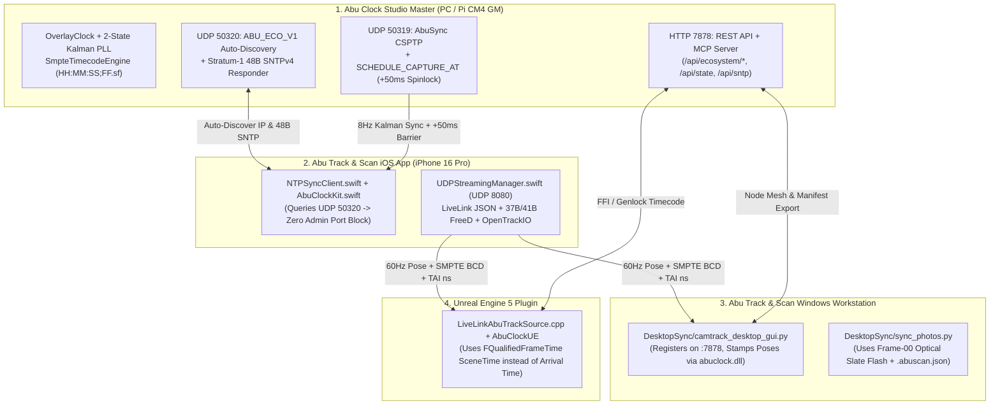

# Abu Track & Scan $\leftrightarrow$ Abu Clock Ecosystem Integration Blueprint

**Version:** `v0.0.0.14`  
**Target Ecosystem:**
1. **`Abu Clock` Master Studio & Infrastructure** (`c:\Users\USer\Documents\antigravity\abu-clock`)
2. **`Abu Track & Scan` iOS App** (`C:\Users\USer\.gemini\antigravity\scratch\ios_app_cam_track_01\Sources\`)
3. **`Abu Track & Scan` Windows Workstation** (`C:\Users\USer\.gemini\antigravity\scratch\ios_app_cam_track_01\DesktopSync\`)
4. **`Abu Track & Scan` Unreal Engine 5 Plugin** (`C:\Users\USer\.gemini\antigravity\scratch\ios_app_cam_track_01\UnrealPlugin\LiveLinkAbuTrack\`)

---

## 1. Executive Summary: How to Make `Abu Track & Scan` + `Abu Clock` More Accurate & Seamless

After inspecting the `Abu Track & Scan` codebase (`NTPSyncClient.swift`, `UDPStreamingManager.swift`, `camtrack_desktop_gui.py`, `sync_photos.py`, and `LiveLinkAbuTrackSource.cpp`), we identified **5 high-impact architectural upgrades** that eliminate timing drift, Wi-Fi jitter, privileged port blocks, and manual IP configuration across the entire Abu Ecosystem:



---

## 2. Finding-by-Finding Analysis & Concrete Solutions

### Upgrade 1: Zero-Configuration Ecosystem Auto-Discovery (`UDP 50320` & `/api/ecosystem/*`)
- **Current Limitation in `Abu Track & Scan`:**
  - The user must manually type IP addresses (`targetIP` in `UDPStreamingManager.swift`, `serverIP` in `NTPSyncClient.swift`) whenever Wi-Fi DHCP assigns a new address.
- **How `Abu Clock` Solves It (`crates/abu-network/src/ecosystem.rs`):**
  - `Abu Clock` runs a continuous listener on unprivileged **UDP port `50320`** and **HTTP port `7878`** (`/api/ecosystem/discover` & `/api/ecosystem/register`).
  - When the iOS app broadcasts `"ABU_ECO_V1"` to `255.255.255.255:50320` on launch, `Abu Clock` immediately replies with an `AbuEcosystemDiscoveryBeacon` JSON packet containing:
    - The Master Clock IP & active SMPTE frame rate (`60.0 fps` or `29.97 DF`),
    - The Windows `DesktopSync` Workstation IP and UDP telemetry/video ports (`8080` / `5004`),
    - The Unreal Engine `LiveLinkAbuTrack` IP and port (`8080`).

### Upgrade 2: Replacing One-Shot Port-123 SNTP in `NTPSyncClient.swift` with Port-50320 Stratum-1 SNTP & 2-State Kalman PLL
- **Current Limitation in `Sources/Managers/NTPSyncClient.swift`:**
  1. Connects to **UDP port `123`** (`NWEndpoint.Port(rawValue: 123)!`), which is a privileged port on Windows/macOS and often blocked by Windows Firewall or occupied by the `W32Time` service.
  2. Performs a **single one-shot** `Date().timeIntervalSince1970` offset calculation (`((t2 - t1) + (t3 - t4)) / 2.0`). Because iPhone and PC quartz crystals drift relative to each other by $10\text{–}30\text{ ppm}$ ($10\text{–}30\ \mu\text{s}$ per second), a one-shot offset drifts by $> 18\text{ ms}$ (over 1 full 60 fps frame!) after a 10-minute take.
- **How `Abu Clock` Solves It:**
  1. `Abu Clock` embeds a native **RFC 4330 48-byte SNTPv4 Stratum-1 Responder (`SntpResponder`)** on unprivileged **UDP port `50320`** (and `GET /api/sntp`). Simply changing `port = 50320` in `NTPSyncClient.swift` works immediately on any Windows PC without Administrator rights!
  2. By linking `integrations/abu-track-scan/ios/AbuClockKit.swift` (or feeding periodic 8 Hz / 1 Hz SNTP samples into `OverlayClock`), the iOS app disciplines `mach_continuous_time` (`ARFrame.timestamp`) with a **2-state Kalman PLL** that continuously learns and cancels crystal frequency drift ($\alpha_{\text{freq}}$ in ppb).

#### Drop-In Swift Upgrade for `Sources/Managers/NTPSyncClient.swift`:
```swift
import Foundation
import Network

/// Drop-in upgrade for NTPSyncClient.swift in Abu Track & Scan:
/// 1. Uses unprivileged AbuClock port 50320 (no Windows port 123 admin block).
/// 2. Supports 1-packet LAN Auto-Discovery ("ABU_ECO_V1") to find the PC IP automatically.
extension NTPSyncClient {
    public static let abuClockUnprivilegedPort: UInt16 = 50320

    /// Auto-discovers the Abu Clock Master & Windows DesktopSync IP on the local subnet.
    public func discoverAbuEcosystem(completion: @escaping (_ masterIP: String?, _ fps: Double?) -> Void) {
        let endpoint = NWEndpoint.hostPort(host: "255.255.255.255", port: NWEndpoint.Port(rawValue: 50320)!)
        let params = NWParameters.udp
        params.allowLocalEndpointReuse = true
        let conn = NWConnection(to: endpoint, using: params)
        conn.stateUpdateHandler = { state in
            if case .ready = state {
                let probe = "ABU_ECO_V1".data(using: .utf8)!
                conn.send(content: probe, completion: .contentProcessed { _ in })
                conn.receiveMessage { data, _, _, _ in
                    defer { conn.cancel() }
                    guard let data = data,
                          let json = try? JSONSerialization.jsonObject(with: data) as? [String: Any],
                          let ip = json["master_ip"] as? String else {
                        completion(nil, nil)
                        return
                    }
                    let num = json["fps_num"] as? Double ?? 60.0
                    let den = json["fps_den"] as? Double ?? 1.0
                    completion(ip, num / max(1.0, den))
                }
            }
        }
        conn.start(queue: .global(qos: .userInitiated))
    }
}
```

---

### Upgrade 3: Eliminating Arrival-Time Wi-Fi Jitter in UE5 `LiveLinkAbuTrackSource.cpp`
- **Current Limitation in `UnrealPlugin/LiveLinkAbuTrack/Source/LiveLinkAbuTrack/Private/LiveLinkAbuTrackSource.cpp`:**
  - At line 131 (`ParseAndPushJSON`) and line 264 (`ParseAndPushFreeD`), the plugin sets:
    ```cpp
    CameraFrameData.WorldTime = FLiveLinkWorldTime(FPlatformTime::Seconds());
    ```
  - Because Wi-Fi UDP packets experience variable queuing bursts ($1\text{ ms}$ to $18\text{ ms}$), stamping `WorldTime` when the packet *arrives* on the PC causes visible micro-stuttering in Unreal Engine's virtual camera and breaks Composure / Take Recorder frame matching.
- **How `Abu Clock` Solves It:**
  - `Abu Clock` natively supports `Abu Track & Scan`'s **37-byte Extended FreeD (`0xD1` + 8B `int64_ms`)**, **41-byte `0xD2` FreeD-TC (`BCD` + `TAI_ns`)**, and **Enriched LiveLink JSON** (`smpteTimecode`, `bcdTimecode`, `taiNs`, `subframePhase`).
  - In `LiveLinkAbuTrackSource.cpp`, populate `CameraFrameData.MetaData.SceneTime` with an `FQualifiedFrameTime` derived from the packet's capture timestamp + `AbuClock` SMPTE timecode!

#### Drop-In C++ Upgrade for `LiveLinkAbuTrackSource.cpp`:
```cpp
#include "Misc/Timecode.h"
#include "Misc/QualifiedFrameTime.h"

// Inside FLiveLinkAbuTrackSource::ParseAndPushJSON(const FString& JsonString):
uint32 BcdTimecode = 0;
double SubframePhase = 0.0;
if (JsonObject->TryGetNumberField(TEXT("bcdTimecode"), BcdTimecode))
{
    const int32 Hours   = ((BcdTimecode >> 28) & 0xF) * 10 + ((BcdTimecode >> 24) & 0xF);
    const int32 Minutes = ((BcdTimecode >> 20) & 0xF) * 10 + ((BcdTimecode >> 16) & 0xF);
    const int32 Seconds = ((BcdTimecode >> 12) & 0xF) * 10 + ((BcdTimecode >> 8)  & 0xF);
    const int32 Frames  = ((BcdTimecode >> 4)  & 0xF) * 10 + (BcdTimecode & 0xF);
    JsonObject->TryGetNumberField(TEXT("subframePhase"), SubframePhase);

    const FFrameRate StudioRate(60, 1);
    const FTimecode SmpteTc(Hours, Minutes, Seconds, Frames, /*bDropFrame=*/false);
    const FFrameTime ExactFrameTime(SmpteTc.ToFrameNumber(StudioRate), static_cast<float>(SubframePhase));
    CameraFrameData.MetaData.SceneTime = FQualifiedFrameTime(ExactFrameTime, StudioRate);
}
```

---

### Upgrade 4: Sub-Millisecond DSLR Hot-Shoe & Optical Flash Calibration in `DesktopSync/sync_photos.py` & `camtrack_desktop_gui.py`
- **Current Limitation in `DesktopSync/sync_photos.py`:**
  - Matches high-resolution Sony/Canon/Nikon DSLR RAW photos against the iPhone's 60 Hz ARKit trajectory (`session.json`) using EXIF timestamps. Standard EXIF `DateTimeOriginal` has only 1-second (or uncalibrated `SubSecTimeOriginal`) resolution and suffers from internal camera RTC drift.
- **How `Abu Clock` Solves It:**
  1. **Optical Slate Calibration (`FRAME 00 FLASH`):** At the start of a scan session, point both the DSLR and the iPhone at the **Abu Clock Master Digital Slate**. At Frame `00` of every second ($0.0 \le \phi < 0.25$), the `FRAME 00 FLASH` beacon turns 100% pure white. Taking a single reference photo of the slate gives `sync_photos.py` the exact sub-millisecond offset between the DSLR's internal EXIF clock and `Abu Clock` TAI time!
  2. **Future-Time Barrier Trigger (`SCHEDULE_CAPTURE_AT`):** Triggering via `AbuScanCoordinator` (`POST http://127.0.0.1:7878/api/trigger`) fires all connected sensors at $T_{\text{now}} + 50\text{ ms}$ with $< 50\ \mu\text{s}$ spinlock precision and automatically exports `.abuscan.json` and Colmap `images.txt` (`<SensorID>_<HHMMSSFF>_<TAI_ns>.<ext>`).

#### Drop-In Python Upgrade for `DesktopSync/camtrack_desktop_gui.py`:
```python
import json
import urllib.request

ABU_CLOCK_API = "http://127.0.0.1:7878"

def register_desktop_workstation_with_abu_clock(local_ip: str = "127.0.0.1"):
    """Registers the Abu Track & Scan Windows Workstation in the Abu Ecosystem Mesh."""
    payload = {
        "node_id": "abutrack-win-workstation",
        "node_kind": "AbuTrackDesktop",
        "display_name": "Abu Track & Scan PC Workstation (DesktopSync)",
        "platform": "Windows Python/CUDA (COLMAP + 3DGS + DSLR Sync)",
        "ip_address": local_ip,
        "telemetry_port": 8080,
        "video_rtp_port": 5004,
        "clock_port": 50319,
        "control_http_port": 7878,
        "protocols": ["UDP 8080 Telemetry", "RTP 5004 Video", "COLMAP/3DGS", "DSLR Sync"],
        "lock_state": "Locked",
        "offset_ns": 0,
        "frame_rate_str": "60.000 Hz (NDF)",
        "last_seen_tai_ns": 0,
    }
    req = urllib.request.Request(
        f"{ABU_CLOCK_API}/api/ecosystem/register",
        data=json.dumps(payload).encode("utf-8"),
        headers={"Content-Type": "application/json"},
        method="POST",
    )
    with urllib.request.urlopen(req, timeout=0.5) as resp:
        return json.loads(resp.read().decode("utf-8"))
```

---

## 3. Complete Wire Protocol Compatibility Matrix (`Abu Clock` $\leftrightarrow$ `Abu Track & Scan`)

| Protocol / Format | Size | Port | Supported in `Abu Clock` (`v0.0.0.14`) | Supported in `Abu Track & Scan` |
| :--- | :--- | :--- | :--- | :--- |
| **Standard FreeD (`0xD1`)** | `29 Bytes` | `UDP 8080` | `FreeDPacket::to_standard_d1_bytes()` | `UDPStreamingManager.swift` / `LiveLinkAbuTrack` |
| **AbuTrack Extended FreeD (`0xD1 + int64_ms`)** | `37 Bytes` | `UDP 8080` | `FreeDPacket::to_abutrack_37b_bytes()` | `UDPStreamingManager.swift` / `camtrack_desktop_gui.py` |
| **AbuClock SMPTE FreeD-TC (`0xD2 + BCD + TAI`)** | `41 Bytes` | `UDP 8080` | `FreeDPacket::to_extended_d2_bytes()` | Ready via `abuclock.dll` / `AbuClockKit.swift` |
| **AbuTrack LiveLink JSON** | UTF-8 JSON | `UDP 8080` | `AbuTrackLiveLinkPacket` (with SMPTE + TAI) | `UDPStreamingManager.swift` / `LiveLinkAbuTrack` |
| **SMPTE RIS OpenTrackIO (`OTrk`)** | Header + JSON/CBOR | `UDP 8080` | `OpenTrackIoPacket` | `UDPStreamingManager.swift` / `camtrack_desktop_gui.py` |
| **RFC 4330 48B SNTPv4 Sync** | `48 Bytes` | `UDP 50320` | `SntpResponder::build_response()` | `NTPSyncClient.swift` |
| **Abu Ecosystem Auto-Discovery** | JSON (`ABU_ECO_V1`) | `UDP 50320` / `:7878` | `AbuEcosystemDiscoveryBeacon` | All iOS, PC, and UE5 Nodes |
