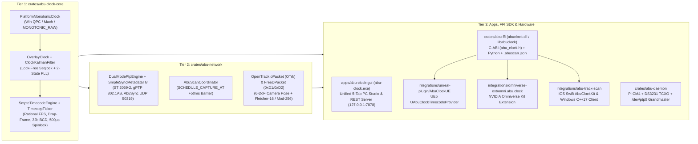

# Abu Clock — Official Developer & Systems Integration Guide (`v0.0.0.13`)

This document is the complete technical reference for software engineers, engine plugin developers (Unreal Engine 5, NVIDIA Omniverse), mobile/desktop capture developers (`Abu-Track-Scan` on iOS & Windows), and embedded Linux engineers building on the **Abu Clock** workspace.

---

## 1. Three-Tier Workspace Architecture



### Repository Directory Layout
| Path | Crate / Target | Description |
| :--- | :--- | :--- |
| [`crates/abu-clock-core`](../crates/abu-clock-core) | `abu-clock-core` (`rlib`) | Hardware monotonic clock, 2-state Kalman `OverlayClock`, SMPTE ST 12-1 rational drop-frame math, 32-bit BCD packing, and hybrid sleep + $500\ \mu\text{s}$ spinlock `TimestepTicker`. |
| [`crates/abu-network`](../crates/abu-network) | `abu-network` (`rlib`) | IEEE 1588-2019 BMCA, 20-byte SMPTE ST 2059-2 SM TLV, `TimestampedUdpSocket`, `AbuScanCoordinator` ($+50\text{ ms}$ barrier), OpenTrackIO (`OTrk`), and FreeD (`0xD1`/`0xD2`). |
| [`crates/abu-ffi`](../crates/abu-ffi) | `abu-ffi` / `abuclock` (`cdylib`, `staticlib`, `rlib`) | `extern "C"` ABI exports (`abu_clock.h`), Python ctypes bindings (`abu_clock.py`), and `.abuscan.json` / Colmap `images.txt` manifest exporter. |
| [`apps/abu-clock-gui/src-tauri`](../apps/abu-clock-gui/src-tauri) | `abu-clock` (`bin`) & `abu_clock_gui_lib` (`lib`) | Unified PC Studio executable (`abu-clock.exe`) with embedded 5-tab UI and local JSON REST control server (`127.0.0.1:7878`). |
| [`crates/abu-daemon`](../crates/abu-daemon) | `abu-daemon` (`bin`) | Headless CLI & Raspberry Pi CM4 / Pi 5 Grandmaster appliance daemon (`--appliance-mode`). |
| [`integrations/unreal-plugin/AbuClockUE`](../integrations/unreal-plugin/AbuClockUE) | UE5 C++ Plugin | Unreal Engine 5 `UTimecodeProvider` + `UAbuClockTickableSubsystem`. |
| [`integrations/omniverse-ext/omni.abu.clock`](../integrations/omniverse-ext/omni.abu.clock) | Omniverse Kit Extension | Python ctypes bridge locking Omniverse timeline and USD stage metadata to `abuclock.dll`. |
| [`integrations/abu-track-scan`](../integrations/abu-track-scan) | iOS Swift & Win C++17 | `AbuClockKit` Swift package (converting `CMSampleBuffer` / `ARFrame` Mach time to TAI) and `AbuClockWinClient.hpp`. |

---

## 2. Core Mathematical & Protocol Specifications

### 2.1 User-Space `OverlayClock` Discipline Equation
`OverlayClock` computes International Atomic Time (TAI) in nanoseconds from the platform monotonic counter $C_{\text{mono}}(t)$ using lock-free atomic sequence locking (`SeqLock`):

$$T_{\text{TAI}}(t) = T_{\text{anchor}} + \bigl(C_{\text{mono}}(t) - C_{\text{mono}}(t_0)\bigr) \cdot \left(1 + \alpha_{\text{ppt}} \times 10^{-12}\right) + \theta_{\text{phase}}$$

- Readers (`now_tai_ns()`, `translate_monotonic_to_tai(c_mono_ns)`) never acquire a mutex.
- Writers (`discipline_from_network_sample(...)`) increment the odd/even `seq` counter around atomic updates to `(t_anchor_tai_ns, c_mono_t0_ns, alpha_freq_ppt, theta_phase_ns)`.

### 2.2 IEEE 1588 / CSPTP 4-Timestamp Offset & Delay Math
Given client request transmit $t_1$, master receive $t_2$, master response transmit $t_3$, and client response receive $t_4$:

$$\theta_{\text{offset}} = \frac{(t_2 - t_1) + (t_3 - t_4)}{2}, \qquad d_{\text{delay}} = \frac{(t_4 - t_1) - (t_3 - t_2)}{2}$$

### 2.3 SMPTE ST 2059-2 Synchronization Metadata TLV (20 Bytes Big-Endian)
| Byte Offset | Field | Wire Value / Type |
| :--- | :--- | :--- |
| `0..2` | `tlvType` | `0x0003` (`TLV_TYPE_ORGANIZATION_EXTENSION`) |
| `2..4` | `lengthField` | `0x0010` (`16` bytes following) |
| `4..7` | `organizationId` | `00-0E-9B` (SMPTE OUI) |
| `7..10` | `organizationSubType` | `00-00-01` (ST 2059-2 Synchronization Metadata) |
| `10..12` | `currentUtcOffset` | `i16` big-endian (`+37` seconds TAI - UTC) |
| `12..16` | `defaultSystemFrameRate (Num)` | `u32` big-endian (e.g. `30000`) |
| `16..19` | `defaultSystemFrameRate (Den)` | 24-bit big-endian (e.g. `1001`) |
| `19` | `timecodeFlags` | `u8` (`0x01` = Drop-Frame, `0x00` = Non-Drop-Frame) |

---

## 3. Integrating via Rust Crates

Add `abu-clock-core` and `abu-network` to your `Cargo.toml`:

```rust
use abu_clock_core::{FrameRate, OverlayClock, SmpteTimecodeEngine, TimestepTicker};
use abu_network::{AbuScanCoordinator, CameraPose6DoF, FreeDPacket};

fn example() {
    // 1. Create a shared lock-free OverlayClock seeded at a TAI nanosecond epoch
    let clock = OverlayClock::new_shared(1_729_180_800_000_000_000);

    // 2. Create a 29.97 Drop-Frame SMPTE ST 12-1 engine
    let engine = SmpteTimecodeEngine::new(FrameRate::FPS_29_97_DF, 0);

    // 3. Synthesize instantaneous timecode, 32-bit BCD word, and sub-frame phase
    let tai_now = clock.now_tai_ns();
    let snap = engine.synthesize_at_tai_ns(tai_now);
    println!("Slate: {} | BCD: 0x{:08X} | Phase: {:.3}",
        snap.timecode.to_slate_string(),
        snap.timecode.to_bcd_u32(),
        snap.phase
    );

    // 4. Schedule a deterministic future-time (+50 ms) multi-sensor capture
    let mut coordinator = AbuScanCoordinator::new(clock.clone(), engine);
    let cmd = coordinator.schedule_single_capture();
    println!("Target TAI: {} | Filename: {}",
        cmd.target_tai_ns,
        cmd.format_capture_filename("CamA", "dng")
    );
}
```

---

## 4. Integrating via C / C++17 Native FFI (`abuclock.dll` / `libabuclock`)

### Step 4.1: Build the Shared Library
```powershell
cargo build --release -p abu-ffi
```
This outputs:
- Windows: `target\release\abuclock.dll` (and import library `abuclock.dll.lib`)
- Header file: [`crates/abu-ffi/include/abu_clock.h`](../crates/abu-ffi/include/abu_clock.h)
- C++17 RAII Wrapper: [`integrations/abu-track-scan/windows/AbuClockWinClient.hpp`](../integrations/abu-track-scan/windows/AbuClockWinClient.hpp)

### Step 4.2: C / C++17 Usage Example
```cpp
#include "abu_clock.h"
#include <cstdio>

int main() {
    // Initialize engine at 29.97 Drop-Frame (30000 / 1001, drop_frame = true)
    AbuClockOpaqueHandle* handle = abu_clock_create(1729180800000000000ULL, 30000, 1001, true);

    // Query disciplined TAI and SMPTE frame snapshot
    AbuClockCFrameSnapshot snap{};
    if (abu_clock_synthesize_now(handle, &snap)) {
        printf("TC: %02u:%02u:%02u;%02u | BCD: 0x%08X | TAI: %llu ns\n",
               snap.hours, snap.minutes, snap.seconds, snap.frames,
               snap.bcd_timecode, (unsigned long long)snap.tai_ns);
    }

    // Pack a 41-byte Extended FreeD-TC (0xD2) UDP telemetry datagram
    AbuClockCPose6DoF pose{1, 15.0, -5.0, 0.25, 1200.0, -300.0, 1750.0, 2048, 4096};
    uint8_t freed_d2[41];
    size_t n = abu_clock_pack_freed_d2(handle, &pose, freed_d2);

    abu_clock_destroy(handle);
    return 0;
}
```

---

## 5. Integrating with Python & NVIDIA Omniverse (`omni.abu.clock`)

The Python ctypes client is located at [`crates/abu-ffi/bindings/python/abu_clock.py`](../crates/abu-ffi/bindings/python/abu_clock.py) and the Omniverse extension is at [`integrations/omniverse-ext/omni.abu.clock`](../integrations/omniverse-ext/omni.abu.clock).

```python
import sys
sys.path.append("crates/abu-ffi/bindings/python")
from abu_clock import AbuClockClient

client = AbuClockClient("target/release/abuclock.dll")
client.tick_network(offset_ns=12.0, delay_ns=380.0)
print("SMPTE:", client.now_smpte())
print("Status:", client.status())
```

Run the automated Omniverse extension test suite:
```powershell
python integrations/omniverse-ext/omni.abu.clock/tests/test_extension.py
```

---

## 6. Integrating with Unreal Engine 5 (`AbuClockUE`) & iOS Swift (`AbuClockKit`)

- **Unreal Engine 5 (`AbuClockUE`):**
  - Copy [`integrations/unreal-plugin/AbuClockUE`](../integrations/unreal-plugin/AbuClockUE) into your UE5 project's `Plugins/` directory.
  - Select `UAbuClockTimecodeProvider` as the project's Custom Timecode Provider in *Project Settings -> Engine -> General Settings -> Timecode*.
- **iOS Swift (`AbuClockKit`):**
  - Add [`integrations/abu-track-scan/ios/AbuClockKit`](../integrations/abu-track-scan/ios/AbuClockKit) as a local Swift Package in Xcode.
  - Call `AbuClockNode.translateMachContinuousTimeToTaiNs(...)` inside `captureOutput(_:didOutput:from:)` or `session(_:didUpdate:)` to convert `CMSampleBuffer` / `ARFrame` timestamps to disciplined TAI nanoseconds.

---

## 7. Automating `Abu Clock` via the Local HTTP JSON REST API (`127.0.0.1:7878`)

When `abu-clock.exe` is running, any external tool (Python script, Elgato StreamDeck, Node-RED, or Unreal Remote Control) can query or control the studio over HTTP JSON:

| Endpoint | Method | Payload Example | Response |
| :--- | :--- | :--- | :--- |
| `/api/state` | `GET` | *(None)* | Full `GuiSlateSnapshot` JSON |
| `/api/config` | `POST` | `{"role":"Master","profile":"SmpteSt2059_2","ptp_domain":1,"priority1":64,"priority2":128,"fps_num":24,"fps_den":1,"drop_frame":false,"user_offset_ns":0,"trigger_lead_time_ms":50,"is_wireless":false,"keep_screen_on_active":true,"auto_sync_enabled":true}` | Updated `GuiSlateSnapshot` JSON |
| `/api/clock` | `POST` | `{"action":"fast_forward_7s"}` (`tick_clean`, `tick_wifi`, `step_50us`, `holdover`, `unlock`, `toggle_autosync`) | Updated `GuiSlateSnapshot` JSON |
| `/api/bmca` | `POST` | `{"remote_priority1":64,"remote_clock_class":6,"remote_priority2":128,"remote_fps_num":25,"remote_fps_den":1,"remote_drop_frame":false}` | Updated `GuiSlateSnapshot` JSON |
| `/api/trigger` | `POST` | `{"mode":"single","frames":1}` or `{"mode":"burst","frames":5}` | Updated `GuiSlateSnapshot` JSON |
| `/api/telemetry`| `POST` | `{"camera_id":1,"pan_deg":10.0,"tilt_deg":-2.0,"roll_deg":0.0,"x_mm":1000.0,"y_mm":0.0,"z_mm":1500.0,"zoom_raw":2048,"focus_raw":4096}` | Updated `GuiSlateSnapshot` JSON |
| `/api/manifest` | `POST` | `{"sensor_id":"SonyA1_Rig03","ext":"arw"}` | Updated `GuiSlateSnapshot` JSON |
| `/api/appliance`| `POST` | `{"gnss_locked":false}` | Updated `GuiSlateSnapshot` JSON |
| `/api/shutdown` | `POST` | *(None)* | Cleanly terminates the running server |
